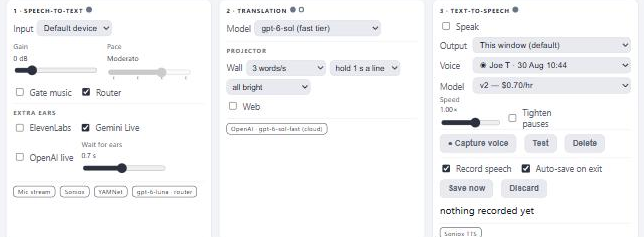
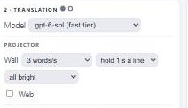
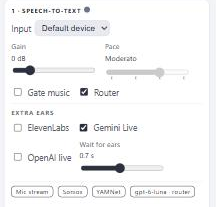

# Catching mis-hears — configuring Sol, the Router, and the extra ears

Áron's biggest remaining failure is not translation — it's Soniox **mishearing** a
word in a way that changes the meaning ("Rusalii" heard as "Ierusalim"). Three
options work together to catch those, and `gpt-6-sol` is the model with the best
*intuition* for them: given a segment, it notices the word that doesn't fit the
sermon and repairs it to the similar-sounding word that does. This guide shows
how to turn them on and how they trade cost and latency.

All of these controls live in the operator UI and need the right API key before
they appear. Your picks persist in the browser (and on the server, for a new browser); the `CT_*` values below are the
server-side defaults and caps, set in `.env` and read at startup (restart after
editing).

---

## The recommended setup, at a glance



- **Model** = `gpt-6-sol (fast tier)` — panel **2 · Translation**
- **Router** ticked — panel **1 · Speech-to-text**
- One **ear** ticked (Gemini Live is the strongest) — panel **1**, *Extra ears*
- Confidence hint on: `CT_UNSURE_BELOW=0.5` in `.env`

```ini
# .env — the recommended accuracy block
OPENAI_API_KEY=sk-...        # enables Sol, the Router, and the OpenAI ear
GEMINI_API_KEY=...           # enables the Gemini Live ear (strongest single ear)
CT_UNSURE_BELOW=0.5          # mark low-confidence Soniox words so Sol can act on them
CT_ROUTER_TIMEOUT_MS=1200    # router check deadline; past it, Soniox's text stands
CT_EAR_WAIT_MS=700           # a sent-on segment waits at most this long for the ears
# CT_ROUTER_MODEL=gpt-6-luna # the router's decision model (default)
# CT_HEARS_FALLBACK=         # blank = gpt-6-sol-fast
```

Why this shape: the Router runs Sol **only on the ~16 % of segments that look
doubtful**, so you get Sol's repair intuition where it matters and Soniox's own
instant text everywhere else. The normal pipeline never waits on any of this.

---

## 1. Pick Sol as the translator

Panel **2 · Translation → Model → `gpt-6-sol (fast tier)`**. Needs `OPENAI_API_KEY`
(without it the option is greyed out).



Two things are already baked in — you don't configure them:

- **Reasoning is pinned to `none`.** A spoken sentence rarely benefits from
  reasoning and every reasoning token is first-word latency.
- **The premium fast service tier** (that's what the `-fast` id means). Sol on
  the default tier is ~0.69 s to first word with a 1.17 s p90; the fast tier
  trims that to **0.59 / 0.62 s**. The tight p90 tail is the part a congregation
  actually notices.

Quality: **121/136 idioms** (level with Sonnet 5.5) and **the best model at
repairing single sound-alike mis-hears** — 20/22 planted near-homophones
unaided, **21/22 with the confidence hint** (§3). That repair strength is the
"good intuition if something feels out of place" worth building the setup around.

> You *can* run Sol as the blanket translator for every caption, but that is the
> expensive, slower-tailed path. Prefer the Router (§2), which spends Sol only
> where it earns its keep.

---

## 2. Turn on the Router

**Settings › 2 Translate → turn on `Decision Router`** (under the Model). Needs `OPENAI_API_KEY`.



With the Router on, Soniox's own translation captions the service, and a fast
check (OpenAI's `gpt-6-luna` decision model, ~0.15–0.3 s) reads each finished
segment and only **sends on** the doubtful ones — a likely mis-hearing, a shaky
translation, or a cuss word — to the translator you picked in Model (Sol). Every
other segment keeps Soniox's instant text.

- Each caption carries a faint **who-translated** note, and the chip under the
  panel shows the router's decision model (`gpt-6-luna · router` in the shot
  above).
- The offensive-words check is narrowed to actual swearing — Bible and preaching
  language passes. On a sermon it sends on **~16 %** of segments (was ~24 % when
  it flagged anything sensitive).
- Order is preserved: a sent-on segment briefly holds the ones behind it for the
  translator's ~0.7 s.

Knobs (`.env`):

| Setting | Default | What it does |
|---|---|---|
| `CT_ROUTER_TIMEOUT_MS` | `1200` | The check's deadline. Past it, Soniox's unchecked text is shown (and the router light's tooltip counts it as "expired"). 1200 ms leaves room for a cold connection from farther away. |
| `CT_ROUTER_MODEL` | `gpt-6-luna` | The decision model. Its prompts were measured with Luna; another model needs re-measuring. |

> Picking `none, fast` as the Model unticks the Router — there's nothing to send
> a doubtful segment *to*.

---

## 3. Give its intuition something to act on — the confidence hint

Soniox reports a per-word confidence. Turn the hint on so low-confidence words
reach the translator tagged "unsure":

```ini
CT_UNSURE_BELOW=0.5    # off by default; words below this confidence are marked unsure (0 = off)
```

It costs **zero** extra latency and lifts Sol's near-homophone repair from 20/22
to **21/22**.

> **The hint is model-specific.** Sol uses it well; `claude-haiku-5-5` is
> actively *misled* by it and never receives one. If you pair the hint with a
> model, pair it with Sol.

---

## 4. Add the extra ears

Same panel **1 · Speech-to-text → *Extra ears*** — tick one or more of
**ElevenLabs**, **Gemini Live**, **OpenAI live**. Each ear needs its own key
(`ELEVENLABS_API_KEY`, `GEMINI_API_KEY`, `OPENAI_API_KEY`); an ear with no key
simply doesn't appear.

The ears are **witnesses**, not captioners: up to three more realtime
recognizers hear the same audio. When the Router sends a segment on as a likely
mis-hearing, each ticked ear's reading of those same words goes to Sol as a clue
to what was really said. That segment waits briefly — until each ear has the
segment's **last word and one past it**, at most `CT_EAR_WAIT_MS` after the seal
(default 0.7 s; longer gained nothing). Only the Router's sent-on
mis-hearings wait; everything else takes the ears as they stand, and the normal
pipeline never waits.

On a whole 82-minute sermon with 27 meaning-changing Soniox mis-hears, the
translator got **20** right with no ears and **26** with all three at +0.7 s,
with no harm on the control segments. **Gemini Live is the single strongest ear**
and the least noisy, so one ear (Gemini Live) is the high-value default; add the
other two for the hardest services.

| Setting | Default | What it does |
|---|---|---|
| `CT_EAR_WAIT_MS` | `700` | How long a sent-on segment waits for the ears (0–1500 ms; the slider's cap). |
| `CT_EARS` | on | Blank/`1` enables the feature; `CT_EARS=0` hides and disables every ear. |

> Each ticked ear streams the **whole service** and is billed for it (it listens
> continuously, not just on sent-on segments). Start with one ear.

---

## 5. Keep Sol as the audio-fallback

If you also run the `gemini-3.6-flash + audio` model (it hears each caption's own
audio), Sol is already its fallback: when Gemini has no first word within
`CT_HEARS_FIRST_S` (2.5 s), the caption falls to `CT_HEARS_FALLBACK` on the text
alone — fast, and good at the same repair job. Leave both blank to keep the
defaults:

```ini
CT_HEARS_FIRST_S=      # blank = 2.5 s
CT_HEARS_FALLBACK=     # blank = gpt-6-sol-fast
```

---

## Three presets

| | Quality-first | **Balanced (recommended)** | Lowest-cost |
|---|---|---|---|
| Model | `gpt-6-sol (fast tier)` | `gpt-6-sol (fast tier)` | `claude-haiku-4-5` |
| Router | on | on | off |
| Ears | all three | Gemini Live only | none |
| `CT_UNSURE_BELOW` | `0.5` | `0.5` | `0` |
| Mis-hears caught (of 27) | 26 | ~24–25¹ | 20 |
| Added cost | 3 ear streams + Sol on ~16 % | 1 ear stream + Sol on ~16 % | none |
| Added latency | sent-on segments wait ≤0.7 s | sent-on segments wait ≤0.7 s | none |

¹ The Router alone sends on 24 of the 27; one ear closes most of the rest.
Keys are a premium on Sol's fast tier and per-service on each ear — see below.

---

## Cost & latency notes

- **Sol's fast tier is billed at a premium.** Running it through the Router
  (on ~16 % of segments) rather than on every caption is both cheaper *and*
  lower average latency.
- **Each ear is billed for the whole service**, since it listens continuously.
  One ear (Gemini Live) gets most of the benefit; add more only when accuracy
  matters more than cost.
- **The confidence hint is free** — no extra call, no extra latency.
- **None of this slows the normal pipeline.** Only a Router sent-on segment ever
  waits (≤ `CT_EAR_WAIT_MS`), and the ~84 % of captions Soniox gets right are
  untouched.

---

## How to check it's working

Open **Diagnostics** (the pulse button at the top right) and watch a live service:

- **On the captions** — a faint who-translated note, and a router chip on
  sent-on lines.
- **The router light** (gpt-6-luna, at the top) — its tooltip shows the
  *check* (the round trip), *hold*, *sent on* (count since Clear), and *expired*
  (checks that ran past `CT_ROUTER_TIMEOUT_MS`); the light turns orange past 1
  in 10 expired — raise the timeout or check the network if so.
- **Debug panel** — the server-side check time and why each segment was sent on,
  plus how often an ear's reading was there in time.
- **Network check** button — probes DNS/TCP/TLS to every provider, so you can
  tell a slow OpenAI leg (hurting the router/Sol) from a slow pipeline.

If *expired* is high or the router check is slow, that's a transport problem
(run Network check), not a reason to turn the Router off.

---

## Reference: every knob

| `.env` key | Default | Purpose |
|---|---|---|
| `OPENAI_API_KEY` | — | Enables the Sol option, the Router, and the OpenAI ear |
| `GEMINI_API_KEY` | — | Enables the Gemini Live ear and the `gemini-3.6-flash + audio` model |
| `ELEVENLABS_API_KEY` | — | Enables the ElevenLabs ear (and ElevenLabs TTS) |
| `CT_ROUTER_TIMEOUT_MS` | `1200` | Router check deadline (ms) |
| `CT_ROUTER_MODEL` | `gpt-6-luna` | Router decision model |
| `CT_UNSURE_BELOW` | `0` (off) | Soniox confidence below which a word is marked unsure |
| `CT_EARS` | on | `0` hides/disables all extra ears |
| `CT_EAR_WAIT_MS` | `700` | Max wait for the ears on a sent-on segment (ms) |
| `CT_HEARS_FIRST_S` | `2.5` | How long `gemini-3.6-flash + audio` may take to first word before falling back |
| `CT_HEARS_FALLBACK` | `gpt-6-sol-fast` | Model the audio path falls back to on the text alone |

See also [README](../README.md) → *Catching mis-hears* and *Models in the
pipeline*, and [QUICKSTART](../QUICKSTART.md).
